<div align="center">

# GameArena

### Documento técnico del proyecto

**Plataforma web para gestionar competiciones de videojuegos**

<br>

| |                                                      |
|---|------------------------------------------------------|
| **Creador** | Unai Pescador                                        |
| **Curso** | 2.º DAW (Desarrollo de Aplicaciones Web) · 2026/2027 |
| **Módulo** | Desarrollo Web en Entorno Cliente                    |
| **Centro** | IES Juan Garcia Valdemora                            |
| **Fecha** | 14 de noviembre de 2026                              |
| **Versión** | 1.0                                                  |

</div>

<div style="page-break-after: always;"></div>

## Índice

3. [Introducción](#3-introducción)
4. [Objetivos del proyecto](#4-objetivos-del-proyecto)
5. [Requisitos funcionales y no funcionales](#5-requisitos-funcionales-y-no-funcionales)
6. [Análisis y diseño](#6-análisis-y-diseño)
7. [Metodología de trabajo](#7-metodología-de-trabajo)
8. [Temporalización con microentregas](#8-temporalización-con-microentregas)
9. [Conclusiones iniciales](#9-conclusiones-iniciales)

<div style="page-break-after: always;"></div>

## 3. Introducción

**GameArena** es una aplicación web para organizar y consultar competiciones de videojuegos. Permite registrar videojuegos y jugadores, crear torneos, inscribir jugadores en ellos y consultar la clasificación de cada competición.

**¿Para quién es?** Para comunidades de jugadores, asociaciones y organizadores de torneos pequeños que quieren gestionar sus competiciones en un único sitio, sin hojas de cálculo ni mensajes sueltos. También para los jugadores, que pueden consultar los torneos abiertos y su historial de participaciones.

**¿Qué problema resuelve?** Organizar un torneo suele implicar datos dispersos: quién participa, en qué juego, con qué premio, en qué estado está la competición. GameArena centraliza esa información, impide inscripciones incorrectas (por ejemplo, en un torneo ya cerrado o con un jugador repetido) y mantiene los datos guardados en el servidor.

**Cómo está construido.** El proyecto tiene dos partes que se comunican por HTTP:

- **Cliente (frontend):** una página HTML, CSS y JavaScript sin frameworks que consume la API con `fetch`.
- **Servidor (backend):** una API REST en **Spring Boot**, con los datos guardados en una base de datos **H2**.

## 4. Objetivos del proyecto

### Objetivo general

Desarrollar una aplicación web completa, con cliente y servidor conectados mediante una API REST, que permita gestionar videojuegos, jugadores, torneos e inscripciones de forma clara, accesible y con control de errores.

### Objetivos específicos

1. **Diseñar una API REST** con Spring Boot organizada en capas (controlador, servicio, repositorio y modelo), con 19 operaciones que cubran el caso de uso.
2. **Modelar los datos** de videojuegos, jugadores, torneos y participaciones, con sus relaciones y reglas de integridad.
3. **Construir una interfaz web responsive y accesible** con HTML, CSS y JavaScript, basada en una guía de estilo coherente.
4. **Conectar cliente y servidor** con `fetch`, de modo que los datos se carguen solos y cualquier acción de la página dé el mismo resultado que en Postman.
5. **Gestionar los errores** del servidor (400, 404, 409, 500) y la falta de conexión, avisando siempre al usuario en lugar de dejar la pantalla en blanco.

## 5. Requisitos funcionales y no funcionales

### 5.1 Requisitos funcionales del MVP

| Id | Requisito |
|---|---|
| RF-01 | El sistema permite **listar, ver, crear, editar y eliminar jugadores**. |
| RF-02 | Un jugador tiene alias, correo válido y nivel entero del 1 al 10. El servidor comprueba que el alias no esté vacío, que el correo contenga `@` y que el nivel esté entre 1 y 10. El cliente añade la comprobación de longitud (2-20 caracteres) y de alias repetido. |
| RF-03 | El sistema permite **listar, ver y crear videojuegos**. Los videojuegos no se editan ni se eliminan. |
| RF-04 | El sistema permite **listar, ver, crear, editar y eliminar torneos**. |
| RF-05 | Todo torneo tiene un videojuego y un estado válido: `ABIERTO`, `EN_CURSO` o `FINALIZADO`. |
| RF-06 | El sistema permite **filtrar torneos** por estado, por videojuego o por ambos a la vez. |
| RF-07 | El sistema permite **buscar** torneos y jugadores por texto. |
| RF-08 | El sistema permite **inscribir un jugador en un torneo** únicamente si el torneo está `ABIERTO`. |
| RF-09 | Un jugador no puede inscribirse dos veces en el mismo torneo. |
| RF-10 | El sistema muestra los **participantes de un torneo** y los **torneos de un jugador**, con puntos y posición. |
| RF-11 | **No se puede eliminar** un torneo con participantes ni un jugador con participaciones. |
| RF-12 | El sistema muestra un **aviso claro** cuando el servidor responde con un error o no está disponible. |
| RF-13 | Los datos se cargan automáticamente al abrir cada pantalla. |
| RF-14 | Eliminar un jugador o un torneo exige **confirmación** del usuario. |

### 5.2 Requisitos no funcionales del MVP

| Id | Requisito |
|---|---|
| RNF-01 | **Usabilidad:** navegación clara, formularios con etiquetas persistentes y mensajes de error junto al campo. |
| RNF-02 | **Accesibilidad:** enlace «Saltar al contenido», uso de etiquetas ARIA, foco visible, contraste suficiente y estados que no dependen solo del color. |
| RNF-03 | **Diseño adaptable:** la interfaz funciona en escritorio, tableta y móvil (puntos de corte en 1100, 800 y 520 px). |
| RNF-04 | **Arquitectura:** el servidor separa controladores, servicios, repositorios y modelo. |
| RNF-05 | **Seguridad básica:** el texto que llega del servidor se escapa antes de pintarlo en el HTML. |
| RNF-06 | **Mantenibilidad:** una única función (`api()`) concentra todas las peticiones del cliente, y el código está comentado. |
| RNF-07 | **Fiabilidad:** ante respuestas lentas o antiguas, la interfaz ignora las que ya no corresponden a la pantalla actual. |
| RNF-08 | **Rendimiento:** el buscador de texto filtra en el navegador sin nuevas peticiones. |

### 5.3 Mejoras futuras

| Id | Mejora |
|---|---|
| MF-01 | Registro e inicio de sesión de usuarios, con roles (organizador y jugador). |
| MF-02 | Torneos por equipos, además de la modalidad individual actual. |
| MF-03 | Edición de puntos y posición de cada participante desde la interfaz. |
| MF-04 | Editar y eliminar videojuegos, con las comprobaciones necesarias. |
| MF-05 | Base de datos de producción (MySQL o PostgreSQL) como alternativa a H2. |
| MF-06 | Paginación y ordenación de las listas. |
| MF-07 | Pruebas automáticas del servidor y del cliente. |
| MF-08 | Despliegue en un servidor público. |
| MF-09 | Validaciones completas en el servidor: alias único (restricción en la base de datos), longitud del alias, formato completo del correo y género obligatorio, por ejemplo con Bean Validation. |

## 6. Análisis y diseño

### 6.1 Usuarios destinatarios

| Usuario | Qué necesita |
|---|---|
| **Organizador** | Crear torneos, gestionar sus datos y controlar las inscripciones. |
| **Jugador** | Consultar torneos abiertos, inscribirse y ver su historial y su clasificación. |
| **Visitante** | Explorar los videojuegos y los torneos disponibles. |

### 6.2 Arquitectura

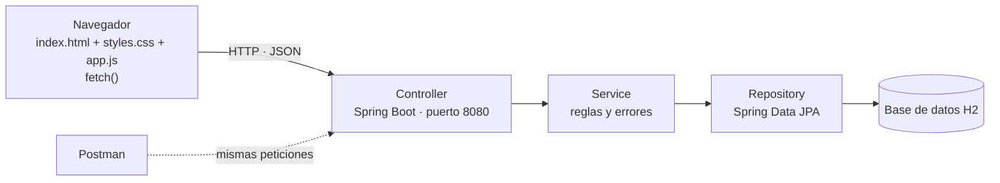

**Flujo de una acción:** botón → función de JavaScript → `fetch` → controlador → servicio → repositorio → JSON → página.

**Tecnologías y versiones** (según el `pom.xml`):

| Tecnología | Versión / dependencia | Uso |
|---|---|---|
| Java | 17 | Lenguaje del servidor. |
| Spring Boot | 4.1.2 | Framework del servidor. |
| Maven | `spring-boot-maven-plugin` | Gestión de dependencias y arranque. |
| Spring Web MVC | `spring-boot-starter-webmvc` | Controladores REST y conversión a JSON. |
| Spring Data JPA | `spring-boot-starter-data-jpa` | Entidades, repositorios y acceso a datos con Hibernate. |
| H2 | `h2` (runtime) | Base de datos del proyecto. |
| Consola H2 | `spring-boot-h2console` | Consulta de las tablas desde el navegador. |
| Pruebas | `spring-boot-starter-data-jpa-test` y `spring-boot-starter-webmvc-test` | Dependencias de test incluidas en el proyecto. |
| Cliente | HTML5, CSS3 y JavaScript sin frameworks | Interfaz, con la tipografía Satoshi. |

El proyecto se identifica como `com.gamearena:GameArena:0.0.1-SNAPSHOT` y el servidor escucha en el puerto 8080.

**Estructura del servidor** (paquete `com.gamearena.gamearena`):

| Paquete | Contenido |
|---|---|
| `controller` | `JugadorController`, `VideojuegoController`, `TorneoController`, `ParticipacionController` |
| `service` | `JugadorService`, `VideojuegoService`, `TorneoService`, `ParticipacionService` |
| `repository` | `JugadorRepository`, `VideojuegoRepository`, `TorneoRepository`, `ParticipacionRepository` |
| `model` | `Jugador`, `Videojuego`, `Torneo`, `Participacion`, `EstadoTorneo` (enum) |

**Consultas de los repositorios.** Los cuatro repositorios heredan de `JpaRepository`, que ya ofrece `save`, `findAll`, `findById`, `existsById` y `deleteById`. Además se han definido consultas derivadas: Spring Data las convierte en SQL a partir del nombre del método, sin escribir ninguna implementación.

| Repositorio | Método | SQL equivalente | Petición |
|---|---|---|---|
| `TorneoRepository` | `findByEstado(estado)` | `WHERE estado = ?` | 15 |
| `TorneoRepository` | `findByVideojuegoId(id)` | `WHERE videojuego_id = ?` | 16 |
| `TorneoRepository` | `findByVideojuegoIdAndEstado(id, estado)` | `WHERE videojuego_id = ? AND estado = ?` | 17 |
| `ParticipacionRepository` | `findByJugadorId(id)` | `WHERE jugador_id = ?` | 6 |
| `ParticipacionRepository` | `findByTorneoId(id)` | `WHERE torneo_id = ?` | 18 |
| `ParticipacionRepository` | `existsByJugadorId(id)` | ¿el jugador tiene participaciones? | 5 (409) |
| `ParticipacionRepository` | `existsByTorneoId(id)` | ¿el torneo tiene participaciones? | 14 (409) |
| `ParticipacionRepository` | `existsByJugadorIdAndTorneoId(j, t)` | ¿ya está inscrito? | 19 (409) |

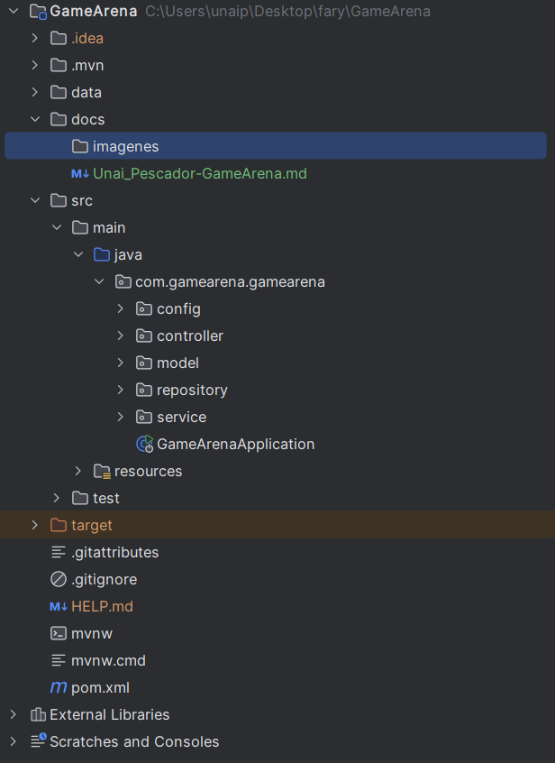

*Figura 1. Estructura del proyecto en IntelliJ: paquetes del servidor y archivos del cliente.*

**Estructura del cliente** (carpeta `resources/static`):

| Archivo | Función |
|---|---|
| `index.html` | Esqueleto de la página. El contenido se inyecta en `<main>`. |
| `styles.css` | Sistema visual: colores, tipografía Satoshi, espaciado y diseño adaptable. |
| `app.js` | Datos, conexión con la API, pantallas, enrutado por `#hash`, eventos y formularios. |
| `assets/` | Fuentes Satoshi e imagen de la portada. |

### 6.3 Diagrama entidad-relación

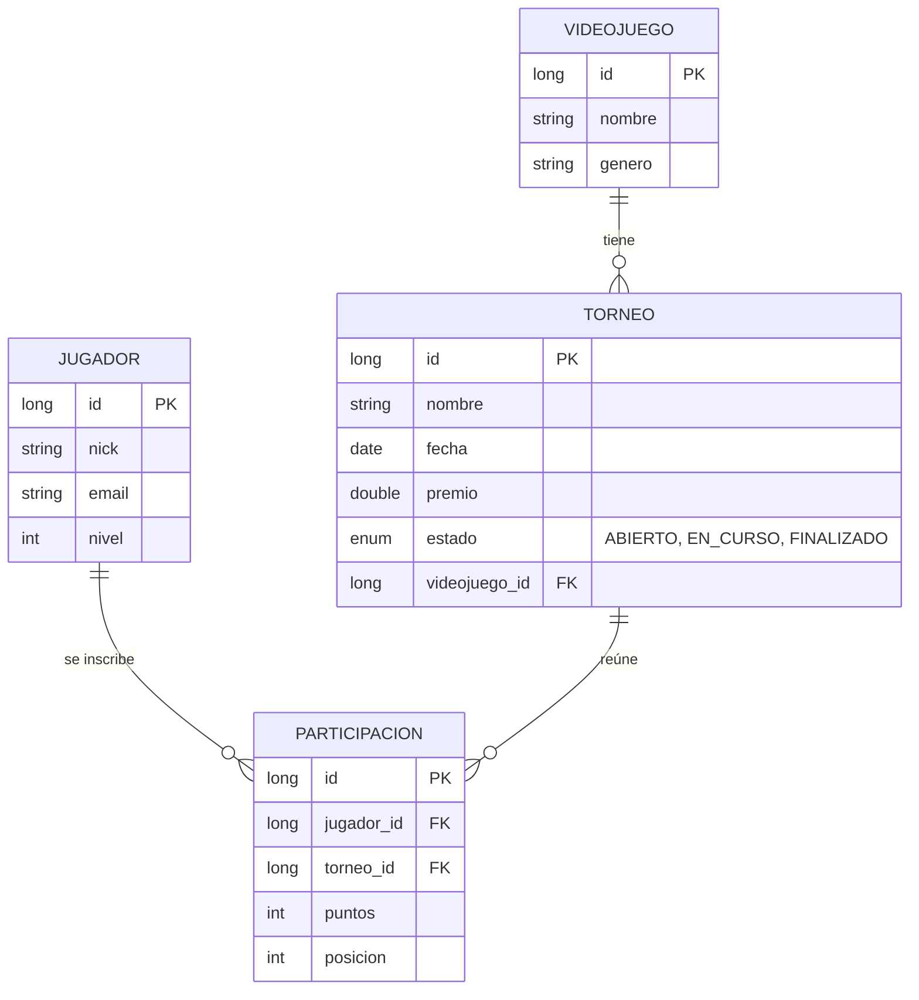

### 6.4 Descripción de las entidades

| Entidad | Descripción | Reglas |
|---|---|---|
| **Videojuego** | Juego sobre el que se organizan torneos. | Solo se crea y se consulta. El nombre es obligatorio. |
| **Jugador** | Persona registrada en la plataforma. | Alias obligatorio, correo con `@` y nivel de 1 a 10. No se elimina si tiene participaciones. |
| **Torneo** | Competición de un videojuego, con fecha, premio y estado. | Nombre, fecha, premio (0 o más) y estado (`ABIERTO`, `EN_CURSO` o `FINALIZADO`) obligatorios. Siempre lleva un videojuego que exista. No se elimina si tiene participantes. |
| **Participación** | Inscripción de un jugador en un torneo, con puntos y posición. | Un jugador solo se inscribe una vez por torneo, y solo en torneos `ABIERTO`. |

**Decisiones de diseño del modelo**

- **`Participacion` es una entidad propia** y no un `@ManyToMany` directo entre jugador y torneo, porque la relación tiene datos propios: los puntos y la posición del jugador en ese torneo. Resuelve la relación N:M con dos relaciones `@ManyToOne` (`jugador_id` y `torneo_id`).
- **`Torneo` es el lado propietario** de su relación con `Videojuego`: la clave foránea `videojuego_id` está en la tabla `torneo`. Al pedir un torneo, el JSON incluye su videojuego.
- **`@Enumerated(EnumType.STRING)`** guarda el estado como texto (`"ABIERTO"`) y no como posición del enum, para que los datos no se estropeen si cambia el orden de los valores.
- **`@JsonIgnore` en las listas inversas** (`Videojuego.torneos`, `Torneo.participaciones` y `Jugador.participaciones`) evita la recursión infinita al convertir a JSON. Gracias a eso, una `Participacion` devuelve su jugador y su torneo, pero estos no devuelven de nuevo sus participaciones.
- **Identificadores autogenerados** (`GenerationType.IDENTITY`): al crear un registro no se envía el `id`.
- **Fechas y premios:** la fecha es un `LocalDate` y viaja como `"2026-11-20"`; el premio es un `Double` en euros.

### 6.5 API REST

El servidor escucha en `http://localhost:8080`.

| Nº | Verbo | Ruta | Función |
|---|---|---|---|
| 1 | GET | `/jugadores` | Listar jugadores |
| 2 | GET | `/jugadores/{id}` | Ver un jugador |
| 3 | POST | `/jugadores` | Crear jugador |
| 4 | PUT | `/jugadores/{id}` | Editar jugador |
| 5 | DELETE | `/jugadores/{id}` | Eliminar jugador |
| 6 | GET | `/jugadores/{id}/participaciones` | Participaciones de un jugador |
| 7 | GET | `/videojuegos` | Listar videojuegos |
| 8 | GET | `/videojuegos/{id}` | Ver un videojuego |
| 9 | POST | `/videojuegos` | Crear videojuego |
| 10 | GET | `/torneos` | Listar torneos |
| 11 | GET | `/torneos/{id}` | Ver un torneo |
| 12 | POST | `/torneos` | Crear torneo |
| 13 | PUT | `/torneos/{id}` | Editar torneo |
| 14 | DELETE | `/torneos/{id}` | Eliminar torneo |
| 15 | GET | `/torneos/estado/{estado}` | Filtrar torneos por estado |
| 16 | GET | `/torneos/videojuego/{id}` | Filtrar torneos por videojuego |
| 17 | GET | `/torneos/videojuego/{id}/estado/{estado}` | Filtrar por videojuego y estado |
| 18 | GET | `/torneos/{id}/participantes` | Participantes de un torneo |
| 19 | POST | `/participaciones` | Inscribir un jugador en un torneo |

**Códigos de respuesta usados:**

| Código | Significado | Ejemplo |
|---|---|---|
| 200 | Operación correcta | Listar o modificar un torneo |
| 201 | Recurso creado | Crear un torneo o inscribir a un jugador |
| 204 | Correcto, sin contenido | Jugador eliminado |
| 400 | Datos no válidos | Estado de torneo inexistente |
| 404 | Recurso no encontrado | Jugador que no existe |
| 409 | Operación no permitida | Eliminar un jugador con participaciones |
| 500 | Error interno del servidor | Fallo inesperado |

**Reglas de negocio y errores controlados.** Se aplican en la capa de servicio, que lanza un `ResponseStatusException` con el código y un mensaje.

| Servicio | Situación | Código |
|---|---|---|
| `JugadorService` | Alias vacío, correo sin `@` o nivel fuera del 1 al 10 | 400 |
| `JugadorService` | Jugador inexistente (ver, modificar, eliminar o consultar participaciones) | 404 |
| `JugadorService` | Eliminar un jugador con participaciones | 409 |
| `VideojuegoService` | Nombre vacío | 400 |
| `VideojuegoService` | Videojuego inexistente | 404 |
| `TorneoService` | Nombre o fecha vacíos, premio vacío o negativo, estado vacío | 400 |
| `TorneoService` | Torneo sin videojuego, o con un videojuego que no existe (crear y modificar) | 400 |
| `TorneoService` | Estado que no existe en la ruta (por ejemplo `/torneos/estado/HOLA`) | 400 |
| `TorneoService` | Torneo inexistente (ver, modificar, eliminar o consultar participantes) | 404 |
| `TorneoService` | Videojuego inexistente en los filtros por videojuego (peticiones 16 y 17) | 404 |
| `TorneoService` | Eliminar un torneo con participaciones | 409 |
| `ParticipacionService` | Falta el jugador o el torneo en el cuerpo | 400 |
| `ParticipacionService` | El jugador o el torneo no existen | 404 |
| `ParticipacionService` | El torneo no está `ABIERTO` | 409 |
| `ParticipacionService` | El jugador ya está inscrito en ese torneo | 409 |

Si la inscripción no trae puntos, el servicio los inicializa a 0.

**Pruebas en Postman.** Las peticiones están organizadas en carpetas (Jugadores, Videojuegos, Torneos, Participaciones y Errores controlados).

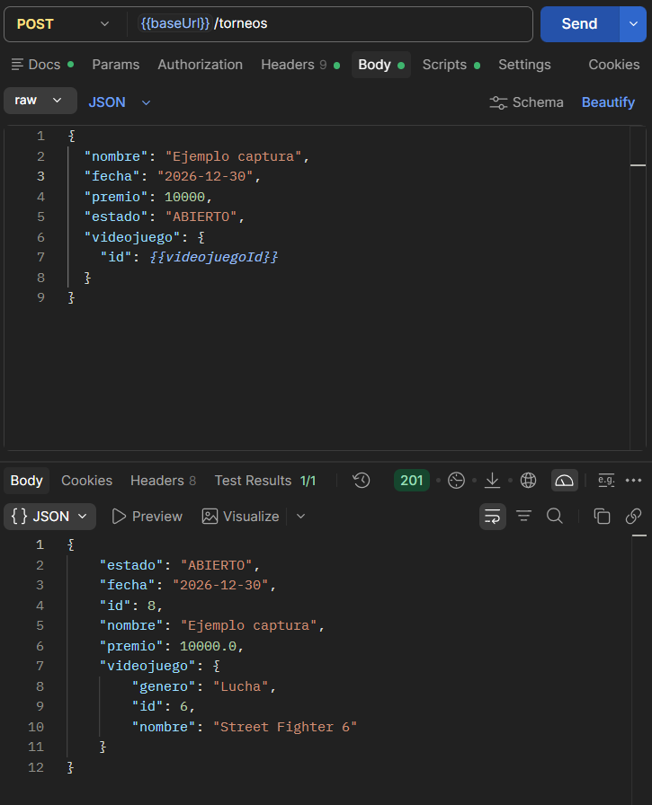

*Figura 2. Petición 12, `POST /torneos`: cuerpo JSON enviado y respuesta 201 con el torneo creado.*

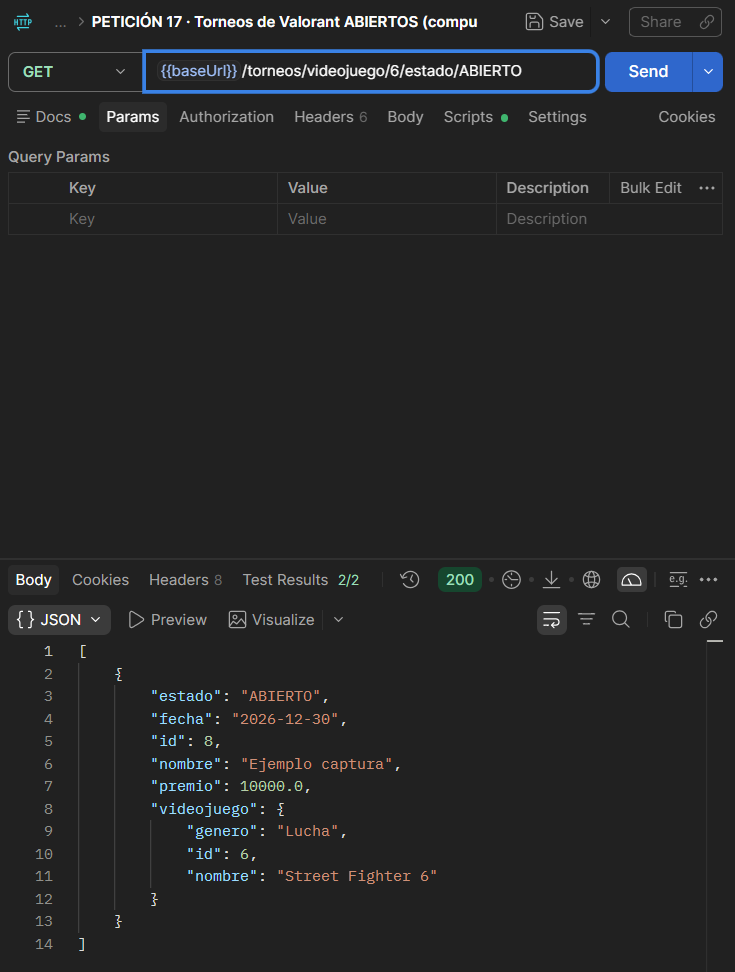

*Figura 3. Petición 17, `GET /torneos/videojuego/{id}/estado/{estado}`: respuesta 200 con los torneos que cumplen las dos condiciones.*

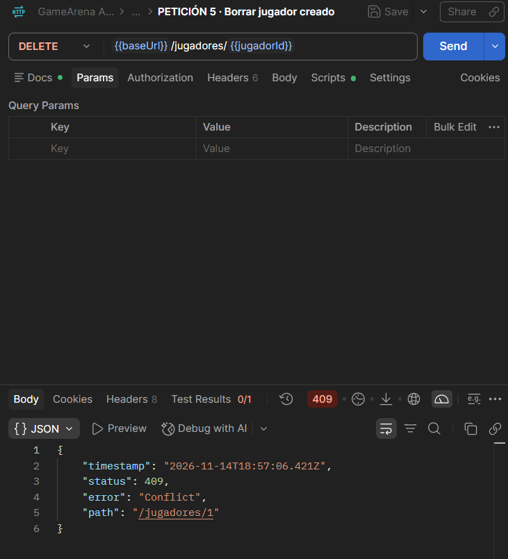

*Figura 4. Error controlado: `DELETE /jugadores/{id}` de un jugador con participaciones responde 409.*

**Ejemplo de JSON para crear un torneo (petición 12):**

```json
{
  "nombre": "Copa GameArena",
  "fecha": "2026-12-05",
  "premio": 500,
  "estado": "ABIERTO",
  "videojuego": { "id": 1 }
}
```

### 6.6 Pantallas principales

| Pantalla | Ruta (`#hash`) | Qué muestra |
|---|---|---|
| Inicio | `#inicio` | Portada, resumen de cifras, torneos destacados y videojuegos. |
| Torneos | `#torneos` | Listado con buscador, filtros por juego y estado, y vista de tarjetas o tabla. |
| Detalle de torneo | `#torneo/{id}` | Datos, participantes y acciones (inscribir, editar, eliminar). |
| Formulario de torneo | `#torneo/nuevo`, `#torneo/{id}/editar` | Alta y edición. |
| Inscripción | `#inscripcion/{id}` | Selección de un jugador libre para el torneo. |
| Videojuegos | `#videojuegos`, `#videojuego/{id}` | Listado, ficha con sus torneos y alta. |
| Jugadores | `#jugadores`, `#jugador/{id}` | Tabla con buscador, ficha y formularios de alta y edición. |
| Participaciones | `#participaciones` | Torneos de un jugador, con puntos y posición. |
| Guía de estilo | `#guia` | Identidad visual, colores, tipografía y componentes. |

### 6.7 Prototipo y capturas

Antes de programar la interfaz se definió una guía de estilo con los colores, la tipografía Satoshi, el espaciado, los componentes y los estados. Funciona como prototipo visual y está incluida en la propia web, en `#guia`.

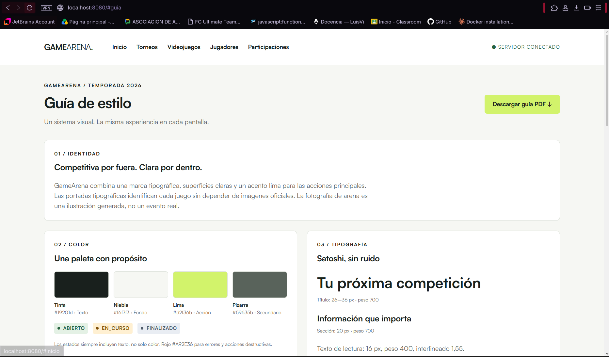

*Figura 5. Guía de estilo: identidad, color, tipografía y componentes.*

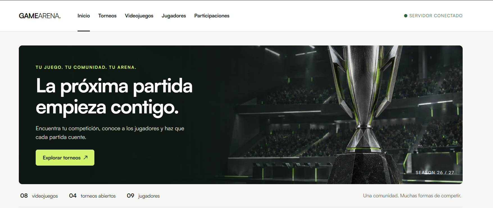

*Figura 6. Pantalla de inicio.*

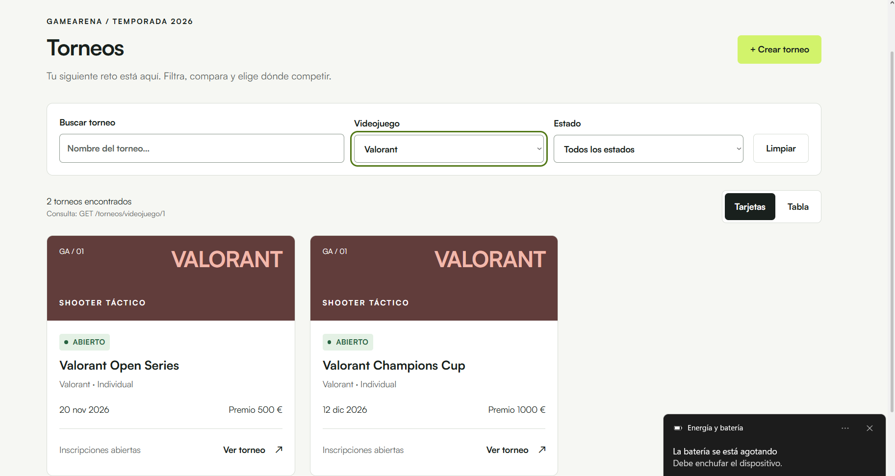

*Figura 7. Listado de torneos con buscador y filtros por videojuego y estado.*

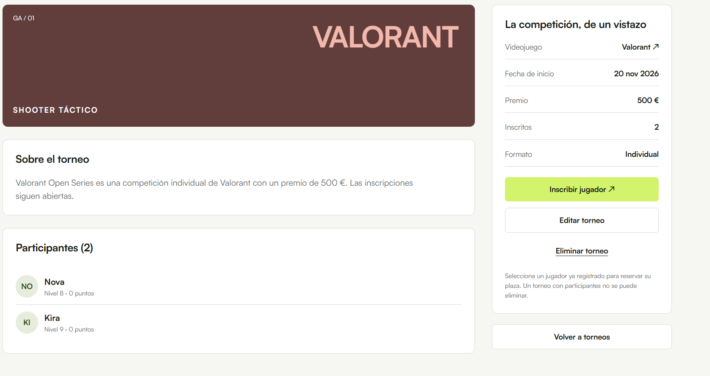

*Figura 8. Ficha de un torneo con sus participantes y acciones.*

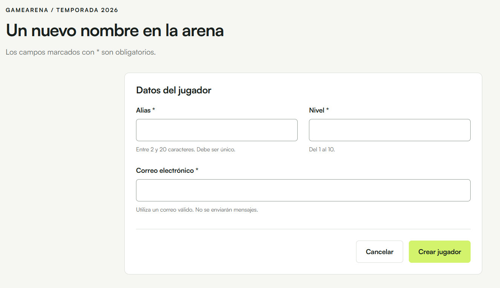

*Figura 9. Formulario de alta de jugador.*

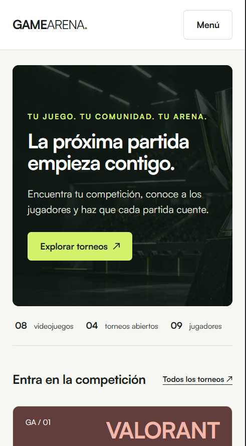

*Figura 10. Versión móvil de la interfaz.*

## 7. Metodología de trabajo

**Metodología:** híbrida, con un tablero **Kanban** (*Por hacer*, *En curso*, *Hecho*) y entregas semanales cortas inspiradas en **Scrum**. Cada semana termina con una microentrega que se puede probar.

**Roles del equipo:**

| Rol | Persona | Responsabilidades |
|---|---|---|
| Desarrollo del backend | Unai Pescador | API REST, modelo de datos, servicios y reglas de negocio. |
| Desarrollo del frontend | Unai Pescador | Maquetación, estilos, JavaScript y conexión con la API. |
| Pruebas y documentación | Unai Pescador | Pruebas con Postman y redacción de este documento. |

**Herramientas digitales:**

| Herramienta | Uso |
|---|---|
| IntelliJ IDEA | Desarrollo del servidor en Spring Boot y edición del cliente (HTML, CSS y JavaScript). |
| Postman | Pruebas de la API, organizadas por carpetas (Jugadores, Videojuegos, Torneos, Participaciones y Errores controlados). |
| Consola H2 | Comprobación de los datos guardados. |
| Git y GitHub | Control de versiones y repositorio del proyecto. |
| Maven | Gestión de dependencias y arranque del servidor. |

## 8. Temporalización con microentregas

| Semana | Entregable | Descripción | Responsable |
|---|---|---|---|
| 1 | Análisis y diseño | Requisitos, usuarios, diagrama E/R, boceto de las pantallas y guía de estilo. | Unai Pescador |
| 2 | Maqueta del cliente | HTML y CSS responsive de las pantallas principales, con accesibilidad básica. | Unai Pescador |
| 3 | Modelo y repositorios | Entidades, relaciones, enum de estados y repositorios con H2. | Unai Pescador |
| 4 | API REST | Servicios y controladores con las 19 operaciones y control de errores. Colección de Postman. | Unai Pescador |
| 5 | Conexión cliente-servidor | JavaScript con `fetch`, carga automática de listas, formularios y avisos de error. | Unai Pescador |
| 6 | Pruebas, documentación y exposición | Revisión de errores, comparación con Postman, este documento y exposición en clase. | Unai Pescador |

## 9. Conclusiones iniciales

**Retos previstos**

- **Mantener coherentes cliente y servidor.** Los nombres de los campos del JSON y el formato de los objetos anidados (por ejemplo, `videojuego: { id }`) tienen que coincidir exactamente en ambos lados. Cualquier diferencia produce errores 400.
- **Aplicar las reglas del caso de uso en el sitio correcto.** El cliente valida para ayudar al usuario, pero la autoridad final es el servidor, que debe impedir, por ejemplo, borrar un jugador con participaciones.
- **Gestionar la asincronía.** Las peticiones tardan en responder y el usuario puede cambiar de pantalla. Hay que evitar pintar datos antiguos y tratar bien los errores y la falta de conexión.
- **Entender y poder explicar el recorrido completo** de cada acción, desde el botón hasta la base de datos.

**Parte más compleja**

La parte más compleja es **la gestión de las participaciones**: relaciona jugadores y torneos, depende del estado del torneo, no admite duplicados y condiciona el borrado de otras entidades. También es la que más peticiones combina en una sola pantalla.

**Reflexión final**

GameArena ha permitido trabajar de principio a fin una aplicación web real: diseñar los datos, construir una API, crear una interfaz accesible y conectar ambas partes. El principal aprendizaje es que una buena separación de responsabilidades (modelo, servicio, controlador y cliente) hace que cada fallo sea fácil de localizar y de explicar.